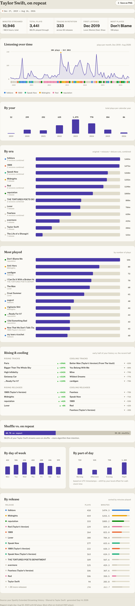
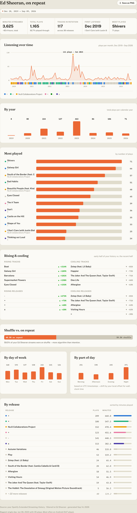
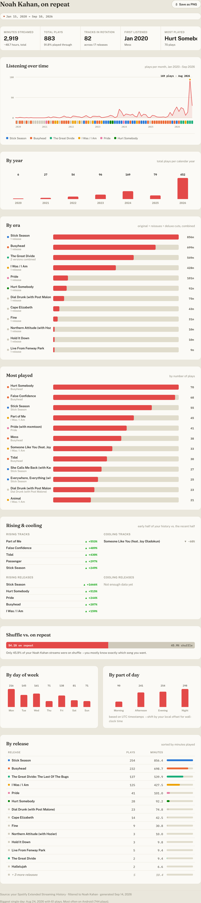

# Rewind Explorer

Pick any artist from your own Spotify listening history and get a full,
Wrapped-style breakdown of them: plays over time, most-played tracks, when
you listen, how shuffle vs. deliberate replays split, and how every edition
of a release (original, deluxe, "Taylor's Version," whatever) stacks up
against each other.

**Everything runs in your browser.** There is no backend, no database, no
upload endpoint. The moment you drop your Spotify export in, the page reads
it, crunches it, and throws it away on refresh. Nobody but you ever sees it
-- including whoever's running this deployment.

## Sample output

<table>
<tr><td></td>
<td></td>
<td></td></tr>
</table>

Three real dashboards, same page, three different data shapes: Taylor Swift
(lots of "Taylor's Version" reissues, folded into one era each), Ed Sheeran
(whose actual album titles are math symbols -- `+`, `-`, `=`, `x` -- and yes,
that's really how they're released), and Noah Kahan (a much smaller library
with a visible 2026 breakout in the timeline).

## Using it

1. Request your **Extended Streaming History** from Spotify: go to
   [spotify.com/account/privacy](https://www.spotify.com/account/privacy/),
   log in, and request it under "Download your data." (This is different
   from the basic account-data export -- make sure you pick the one called
   *Extended streaming history*.)
2. Spotify emails you a download link within a few days.
3. Open this site, drop the `.zip` it sends you (no need to unzip it first),
   and search for any artist you've played at least 3 times.

The basic **Account data** export (`StreamingHistory_music_*.json`) works
too, if that's what you already have. It only covers the last year and has
no album, skip, shuffle or device info, so the by-release, by-era, shuffle
and "rising releases" sections are hidden and "played through" becomes
"past 30 seconds.

## Running it yourself

It's a static site -- no build step, no dependencies to install.

```bash
git clone https://github.com/Rubemat20/spotify-rewind-explorer.git
cd spotify-rewind-explorer
python -m http.server 8000   # or any static file server
```

Then open `http://localhost:8000`.

## Deploying your own copy

Fork this repo, then on [vercel.com](https://vercel.com) choose
**Add New -> Project -> Import Git Repository** and point it at your fork.
No build command, no environment variables, no framework preset needed --
it's plain HTML/CSS/JS. Vercel serves it as-is.

## How it works

- `js/upload.js` reads whatever you drop -- a `.zip`, loose `.json` files, or
  a folder -- using [JSZip](https://stuk.github.io/jszip/) to unpack archives
  in-browser, and keeps only the `Streaming_History_Audio_*.json` entries
  (or `StreamingHistory_music_*.json` from the basic export; video/podcast
  history is ignored). If you drop both exports, only the extended one is
  used, since it already contains the basic one's year.
- `js/aggregate.js` does the actual analysis: per-artist monthly trends, a
  "same song, every edition" merge that folds a single's plays into its
  parent album, era detection (folds "Album (Deluxe)" / "Album (Taylor's
  Version)" / etc. into one umbrella when it's genuinely a reissue), rising
  vs. cooling tracks (comparing the first half of your history against the
  second), shuffle-vs-repeat, and more.
- `js/app.js` renders it all as hand-built SVG/DOM charts (no charting
  library) and wires up the artist search.

No analytics, no cookies, no tracking pixels. The only network requests this
page makes after it loads are to Google Fonts and the two CDN scripts
(JSZip, html2canvas for the "Save as PNG" button) -- never your data.

## Privacy & legal

- [PRIVACY.md](PRIVACY.md) -- what happens to your data (short version: nothing, it never leaves your browser)
- [TERMS.md](TERMS.md) -- terms of use, accuracy disclaimer, no-warranty
- Not affiliated with, endorsed by, or sponsored by Spotify AB. "Spotify" and
  its logos are trademarks of Spotify AB, referenced here only to describe
  compatibility with Spotify's own data export format. This project does not
  use the Spotify API and never asks for your Spotify login.

## License

MIT -- see [LICENSE](LICENSE). Fork it, rename it, make it yours.
